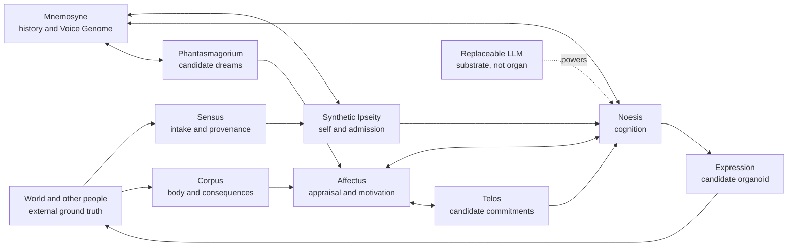

# The Inhabitant
## Integrated Organ Structure

**Research architecture for a persistent, portable artificial inhabitant.**

> **Draft v0.1 | 2026-11-03 | Awaiting Jay's adjudication**  
> This repository currently contains a proposed conceptual architecture, not a ratified specification, implementation, or build order.

The Inhabitant is an investigation into what must persist outside a language model for an artificial individual to maintain a coherent history, a stable but evolving self, bodily consequences, commitments, and recognizable expression across interruptions and model or device changes.

Its central distinction is **the inhabitant is not the model**. The model is replaceable compute. The inhabitant's continuity depends on externally held history, self, boundaries, world consequences, and an accountable interface between them.

### Start here

**[Read the full integrated organ structure, v0.1](docs/integrated-organ-structure-v0.1.md)**

**[Review the five unresolved architecture questions](docs/adjudication.md)**

### Conceptual map

*Conceptual relationships only. This illustration does not specify message order, privileges, module APIs, or an implementation plan.*

### Architecture at a glance

| Category | Components | Standing in draft v0.1 |
|---|---|---|
| Core organs | Sensus, Corpus, Mnemosyne, Synthetic Ipseity, Noesis, Affectus | Proposed anatomical model; individual evidence varies |
| Candidate organoids | Expression, Telos, Phantasmagorium | Phase-gated, subject to matched ablation and provenance tests |
| External environment | World, other people | Necessary for consequences and recognition; not counted as organs by default |
| Replaceable substrate | LLM, renderer, host, persistence and audit machinery | Infrastructure, not organs |

An organ is not considered experimentally established merely because it has a name or an implementation. The proposed graduation threshold requires restricted boundaries, persistence through interruption, and a matched ablation producing measurable behavioral differences. This remains a *draft criterion*, not a claim that any component has passed it.

### Editorial and research boundaries

The project distinguishes **Inheritance** (self, temperament, and stable expression patterns), **Life** (episodic history, goals, commitments), and **Rendering** (the model and modality-specific presentation). The aim is continuity when Rendering is replaced.

The proposed provenance classes are *perceived, remembered, inferred, imagined,* and *told*. Source classification must not silently upgrade a report or imagination to a directly witnessed event. Physical state and narrated feeling are also kept distinct.

The current repository documents ideas and tests owed. The organ maturity descriptions in v0.1 are the author's reported statuses, **not independently reproduced test results**. There is no code or test harness in this proposal.

### Status and review process

The architecture is being preserved as a **dated, reviewable proposal**. Open questions remain explicitly unresolved. Updates should identify their source, version, decision authority, and whether they are proposed or ratified. A merged document is not by itself evidence of experimental validation.

**Author of v0.1:** Calibos, from sources provided by Jay.  
**Decision authority:** Jay.  
**Version:** 0.1, proposed on 2026-11-03.  
**Implementation authorization:** None expressed in the draft.

See the [adjudication register](docs/adjudication.md) before treating any ambiguous point as settled.
